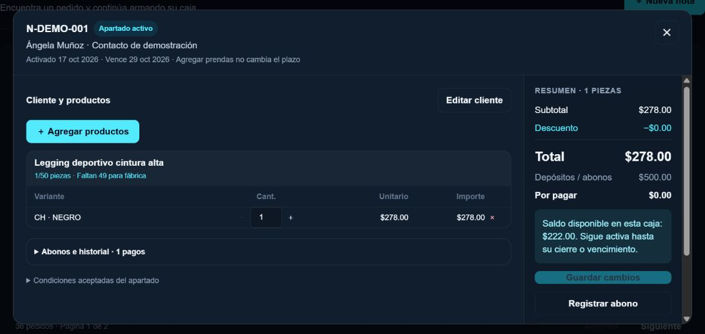
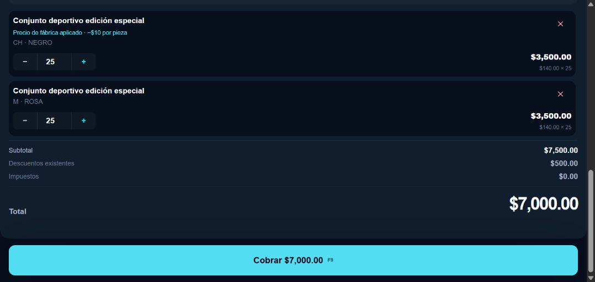
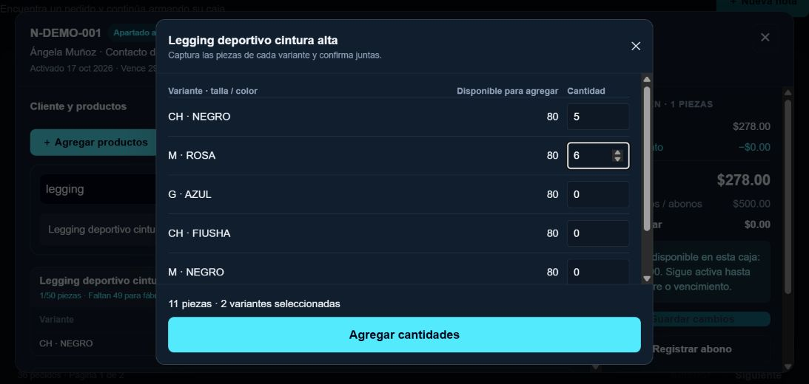
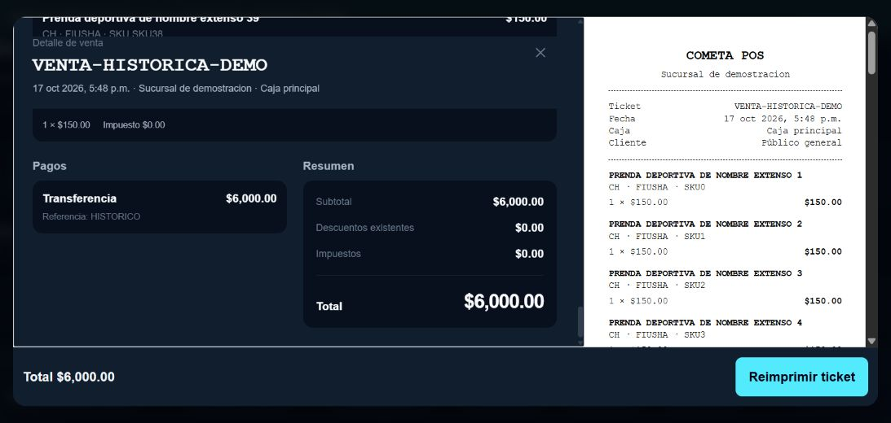

# Retail: cajas abiertas y captura por variantes

## Comportamiento

Magenta permite abrir una caja de cliente con el depósito mínimo configurado aunque no tenga productos. Con productos de $278 y depósitos de $500 permanece activa: por pagar $0 y saldo disponible en esa caja $222. No genera cambio ni una cartera global. Agregar prendas, reducir cantidades y abonar conservan el vencimiento original. Cerrar y entregar siguen siendo acciones explícitas.

El servidor calcula ambos saldos, conserva pagos e historial y reserva únicamente las diferencias al editar. Para cerrar con saldo disponible se requiere permiso administrativo, motivo y reconocimiento explícito de que queda pendiente de resolución; no se reembolsa ni retiene automáticamente. El vencimiento conserva la política aceptada: retención inicial y abonos adicionales pendientes, sin otra entrada de dinero.

El selector compartido de Retail permite capturar varias cantidades por modelo, distingue disponibilidad de cantidad solicitada y suma variantes existentes. Las notas no reservan; las cajas activas reservan al guardar. El detalle de venta usa sus snapshots históricos, permite recorrer todos los renglones y mantiene visible la reimpresión y su error, sin cobrar, descontar ni abrir cajón.

## Aislamiento y compatibilidad

- Compartidos: `pos/register/page.tsx` y `pos/sales/page.tsx`. El selector nuevo y la barra fija de reimpresión se habilitan por perfil Retail; FOOD conserva su selector y flujo de impresión. La corrección de altura del contenedor de vista previa no cambia operaciones comerciales.
- Exclusivos Retail: pantalla de pedidos, API `retail-orders`, helper de comprobantes y nuevo selector `pos-retail-variant-quantities.tsx`.
- API y funciones SQL validan el perfil del negocio en servidor. FOOD no puede invocar las operaciones de cajas.
- `open_box` es opt-in por negocio, con valor global predeterminado falso. La migración activa únicamente Magenta y corrige la clasificación del saldo de sus apartados activos, conservando fechas, condiciones, pagos e inventario. Aborta si detecta un saldo histórico incompatible. No modifica condiciones de otros negocios ni ventas finalizadas.
- Se conserva el descuento publicado de $10 por pieza desde 50 del mismo modelo y su configuración por negocio. No se modifican Reportes, QZ, certificados, claves ni perfiles del cajón.

## Validación

- PostgreSQL desechable: caja vacía con $500; productos $278 con disponible $222; productos $3,000 con por pagar $2,500; abonos repetidos idempotentes; reducciones; fecha fija; cierre administrativo; vencimiento con $500 retenidos y $200 adicionales pendientes; cantidades enteras y disponibilidad.
- Regresión del mismo script: 49/50/51, identidad de modelo y combinaciones, descuentos no duplicados, notas sin reserva, liquidación repetida, reservas por diferencia, última unidad concurrente, edición/pago frente a vencimiento e importes históricos.
- API: permisos, aislamiento, resolución administrativa, perfil FOOD rechazado.
- FOOD: 43 pruebas de shell, acceso y operaciones; roles, mesas, comandas, cocina, cobros e idempotencia.
- Terminal: pruebas existentes de impresión, cajón, deduplicación, efectivo y reimpresión. Sin envíos al hardware.
- TypeScript sin emisión, build Next.js, lint dirigido y diff revisados. La deuda anterior en las páginas compartidas es 6 errores y 3 advertencias de lint; no se incrementó.
- Inspección visual local del componente real con datos sintéticos: captura de 5 y 6 piezas, suma a una variante existente, caja $278/$500 y venta de 40 renglones con teclado y reimpresión accesible. Se conserva el error de impresión en la barra inferior.
- Resolución de poca altura: 1366×650 y viewport 1093×520, equivalente al espacio CSS a 125 %. La herramienta no cambió el zoom nativo de Chrome: la comprobación en el monitor con zoom real 125 % queda pendiente.

Comandos: `node scripts/test-pos-retail-orders-local.mjs`, `node scripts/test-pos-retail-orders-api.mjs`, `node --test scripts/test-pos-food-shell-v1.mjs scripts/test-pos-food-access-server-v1.mjs scripts/test-pos-food-operations-v1.mjs`, `node node_modules/typescript/bin/tsc --noEmit --incremental false --pretty false`; build con `COMETA_BUILD_DIR=.next-retail-check`.

## Evidencia visual

Los datos siguientes son sintéticos, sin pagos ni ventas de prueba en producción.

## Publicación y recuperación

Migración aditiva: `20261018180000_pos_retail_open_box.sql`. El aplicador exige respaldo reciente restaurado, verificación de archivos Storage y hash de la migración. Compara huellas de datos comerciales y usuarios dentro de la transacción; únicamente admite las nuevas columnas y la reclasificación autorizada de saldo de cajas activas de Magenta. Verifica que el cron de vencimiento siga activo cada minuto.

El respaldo y sus diagnósticos permanecen en custodia local privada, fuera de Git y del paquete publicado. La restauración se ensaya en contenedores desechables aislados. Ante fallo de migración se revierte toda su transacción. Después de recibir nuevos depósitos, preferir corrección hacia adelante: no restaurar un respaldo antiguo sobre pagos posteriores. Si se revierte la aplicación, suspender operaciones de cajas abiertas hasta disponer de una versión compatible con depósitos superiores al total; conservar las columnas, pagos e historial.

## Prueba física pendiente del cajón

El ticket QZ ya imprime según evidencia del negocio. La apertura física continúa pendiente. En Configuración de terminal, con operador autorizado y turno abierto, conservar la impresora/perfil guardados, ejecutar **una** apertura manual con motivo y copiar el mensaje completo y su ID de solicitud. Indicar si se abrió físicamente. Una orden aceptada por QZ no confirma apertura. No alternar pines ni repetir automáticamente una orden incierta. Reimpresión y notas sin pago nunca deben abrirlo.

## Archivos de esta entrega

- `src/app/api/pos/retail-orders/route.ts`
- `src/app/brand/[brandSlug]/components/pos-retail-variant-quantities.tsx`
- `src/app/brand/[brandSlug]/pos/orders/page.tsx`
- `src/app/brand/[brandSlug]/pos/register/page.tsx`
- `src/app/brand/[brandSlug]/pos/sales/page.tsx`
- `src/lib/pos/retail-orders.ts`
- `supabase/migrations/20261018180000_pos_retail_open_box.sql`
- `scripts/apply-pos-open-box-production.mjs`
- `scripts/test-pos-retail-orders-api.mjs`
- `scripts/test-pos-retail-orders-local.mjs`
- `scripts/pos-workspace-fixture.jsx`
- Este documento y las cuatro capturas de `docs/evidence/retail-open-box/`.
